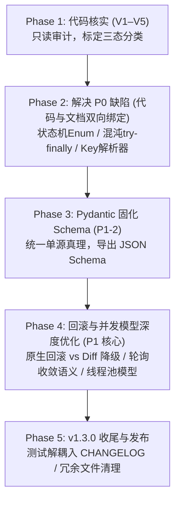

# PNetGimini × EVE IaC 终版研发推进计划 (Final Development Plan)

**制定时间**: 2026-10-18  
**执行原则**: **先验证、再改文档、最后改实现**  
**质量与架构守门人**: TraceGraph MCP Server (Hawkes 时序动力学 + MDL 范式漂移门控)  
**当前基线**: 52/52 单元测试通过，工作区 master 分支纯净  

---

## 0. TraceGraph 贯穿门控协议 (Gatekeeper Standard)

在后续所有涉及代码与架构变动的阶段，统一强制执行三阶门控：
1. **Pre-flight Gate**: 修改任何代码前，调用 TraceGraph 评估受影响文件的传染半径（$\alpha$）、结构势能（$\Phi$），并锁定必须回归的测试用例。
2. **Atomic Implementation**: 确保向后兼容与原子化提交，现有测试必须 100% 保持通过。
3. **Post-flight Audit & Sync**: 触发 `graphify_sync` 与 `detect_paradigm_drift`，确保无新增循环依赖（SCC=0）且无架构范式漂移。

---

## 1. 研发阶段排期与执行步骤

---

### Phase 1: 代码与现实核实 (V1–V5)
* **核心目标**: 纯只读审计与测试运行，不改动任何生产代码与规范，将 5 个疑点明确分类为：
  - `[已在实现解决]`：代码已具备，仅需规范补充说明。
  - `[确实存在风险]`：需要代码级重构，排入后续 Phase。
  - `[无法确认/需测试]`：需补充靶机验证。
* **核实项清单**:
  - **V1 (`ConfigDiffEngine`)**: 检查对“修改值”（如 IP 由 A 改 B、OSPF cost 修改）的处理逻辑。验证 `no ip address` 是否会导致旧值丢失而非还原。
  - **V2 (并发模型)**: 检查 `AsyncDeploymentEngine` 与 Netmiko（同步阻塞）的结合方式（是否使用 `run_in_executor` 线程池）。
  - **V3 (测试覆盖度)**: 核查 52 个单元测试的断言深度，是否覆盖了回滚失败、混沌注入超时的异常分支。
  - **V4 (混沌恢复安全)**: 检查 `ChaosOrchestrator` 在中途抛出异常或外部强制终止时，是否能百分之百恢复链路。
  - **V5 (健康门收敛)**: 检查 `HealthGateEngine` 的 OSPF Full、BGP Established 是单次瞬时判定还是带有超时重试的轮询。
* **交付产物**: 输出报告至 [`devlog/V1_V5_VERIFICATION_REPORT.md`](file:///D:/OneDrive/2025/Alain/pythonprogram/PnetGimini/devlog/V1_V5_VERIFICATION_REPORT.md)。

---

### Phase 2: P0 级核心契约修复（代码与文档同步）
* **2.1 节点生命周期状态机 (P0-1)**:
  - 在代码中建立状态枚举类 `NodeState` 与合法流转转移表 `VALID_TRANSITIONS`：
    `allocated -> booting -> console_ready -> oob_ready -> configurable -> verified -> converged`
  - 编写脚本从代码定义自动生成规范文档中的 Mermaid 状态机图，防止实现与契约脱节。
* **2.2 混沌测试恢复硬保证 (P0-3)**:
  - 将混沌注入重构为异步上下文管理器（`async with link_suspended(...)`），内置 `try ... finally` 强制解除挂起。
  - 在 `ChaosOrchestrator` 初始化入口增加“启动时清理残留挂起链路”的扫尾逻辑。
  - 编写单元测试模拟中途崩溃场景，验证链路必被恢复。
* **2.3 标识与接口契约一致性 (P0-2)**:
  - 实现显示名到 IaC 稳定键的确定性解析器 `resolve_endpoint_key(display_endpoint)`，解析失败直接抛出结构化异常，严禁模糊猜测。
  - 统一测试与文档中的接口命名规范。

---

### Phase 3: Pydantic 固化声明式 Schema (P1-2)
* **核心目标**: 建立单一事实来源（Single Source of Truth），告别手写 YAML 示例与规范不同步的隐患。
* **执行动作**:
  - 在 `src/models/intent.py` 中使用 `pydantic.BaseModel` 建立完整意图模型，支持 `apiVersion: pnetgimini/v1alpha1` 与 `kind: OperationalIntent`。
  - 导出标准的 JSON Schema 文件，直接挂载/嵌入到规范文档中作为正式字段契约。

---

### Phase 4: 回滚安全性与并发/轮询模型优化 (P1 核心)
* **4.1 回滚分级与原生机制优先 (P1-1)**:
  - 评估设备原生回滚能力（IOS `configure replace`、Junos `rollback`、EOS config session）。
  - 对不支持原生的场景，将 diff 取反作为降级路径，并强制增加“依赖倒序执行”与“值变更重新应用旧基线”的修复逻辑。
* **4.2 健康门收敛轮询与超时语义 (P1-3)**:
  - 为 OSPF/BGP/Ping 断言增加 `polling_interval`（如 2s）与 `timeout_seconds`（如 30s）。
  - 区分“协议尚未收敛（继续重试）”与“硬性错误（直接判负）”。
* **4.3 并发与幂等规范 (P1-4, P1-5)**:
  - 明确 Netmiko 调用的线程池隔离模型与并发上限；
  - 增加链路级互斥锁，防止双测试同时挂起同一条物理链路。

---

### Phase 5: v1.3.0 规范发布与收尾
* **5.1 规范与实现解耦 (P3-1, P3-2)**:
  - 将具体单元测试数量（25/36/52）剥离出技术规范，转移至 `CHANGELOG.md`；
  - 规范文档只保留架构约束、API 契约与明确的阶段验收标准（Exit Criteria）。
* **5.2 冗余清理 (TraceGraph 扫描建议)**:
  - 将根目录下旧版本留存文件（`mainv1.py`, `device_managerv1.py`, `config_to_yamlv1.py` 等）归档至 `archive/`。
* **5.3 规范文档最终核准**:
  - 形成正式 v1.3.0 版 [`docs/EVE_IAC_INTEGRATION_SPEC.md`](file:///D:/OneDrive/2025/Alain/pythonprogram/PnetGimini/docs/EVE_IAC_INTEGRATION_SPEC.md)，准备与 Alain 进行第二轮架构对齐。
