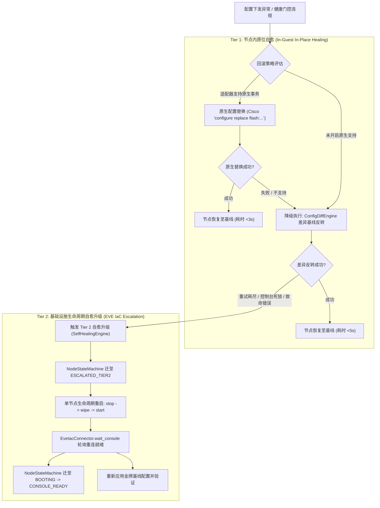

# Task 1 & Task 2 深度研发推进计划 (v3.5 里程碑)

**制定时间**: 2026-10-18  
**目标版本**: PNetGimini v3.5 (Dual-Tier Self-Healing & Native Rollback)  
**执行原则**: **先验证、再改文档、最后改实现**；零中文字符 (src/docs)；100% 向后兼容；TraceGraph 三阶架构门控。  

---

## 1. 任务背景与核心架构

在 v1.3.0 交付后，PNetGimini 已拥有：
- 精确的文本 CLI 差异回滚 (`ConfigDiffEngine`)
- 协议收敛轮询超时 (`HealthGateEngine`)
- 混沌环境恢复保护 (`ChaosOrchestrator`)
- 形式化节点状态机模型 (`NodeStateMachine`)

然而在真实高可用网络孪生中，存在两个核心断层：
1. **回滚机制单一性**: 针对支持原子化配置替换的操作系统（如 Cisco IOS/XE `configure replace`），目前仍使用逐步计算的 `no`/`undo` 语法，缺乏**原生优先、Diff 兜底**的弹性分级。
2. **灾难恢复断崖**: 当设备控制台死锁、认证丢失或差异回滚连续失败时，系统缺乏向 EVE-NG / EVE IaC **Tier 2 基础设施级自愈升级**的执行闭环。

---

## 2. 详细研发分工与架构设计

---

## 3. 分阶段推进排期

### 阶段一：Task 2 设备原生回滚插件 (Native Rollback)
1. **适配器接口扩展 (`src/core/adapters/base.py`)**:
   - `supports_native_rollback() -> bool` (默认返回 `False`)
   - `get_native_snapshot_command(filename: str) -> Optional[str]`
   - `get_native_rollback_command(filename: str) -> Optional[str]`
2. **Cisco 适配器原生实现 (`src/core/adapters/cisco.py`)**:
   - `supports_native_rollback()`: 返回 `True`
   - 快照备份命令: `copy running-config flash:{filename}`
   - 原生替换回滚命令: `configure replace flash:{filename} force`
3. **华为适配器平滑降级 (`src/core/adapters/huawei.py`)**:
   - `supports_native_rollback()`: 返回 `False`（平滑走 Diff 兜底，杜绝误操作）
4. **DeviceManager 编排改造 (`src/core/device_manager.py`)**:
   - 部署前：若适配器支持原生回滚，在设备存储上打上原子基线快照标签；
   - 失败时：优先下发原生回滚命令；若执行成功，标记 `rollback_type = "NATIVE_REPLACE"`；若失败，自动降级到 `ConfigDiffEngine`。

### 阶段二：Task 1 Tier 2 基础设施级自愈升级 (Dual-Tier Escalation)
1. **EVE IaC 节点生命周期接口扩展 (`src/plugins/eve_iac_connector.py`)**:
   - 实现 `stop_node(lab_id, node_id)`
   - 实现 `wipe_node(lab_id, node_id)`
   - 实现 `start_node(lab_id, node_id)`
   - 实现 `reset_node_lifecycle(lab_id, node_id)` (`stop -> wipe -> start`)
   - 实现 `reconcile_lab(lab_id, direction='to_eve', confirm=True)`
2. **自愈编排引擎 (`src/core/self_healing.py`)**:
   - 创建 `SelfHealingEngine`，接入 `NodeStateMachine` 与 `EveIacConnector`；
   - 支持判定触发条件：`CLI_DEADLOCK`, `AUTH_LOSS`, `ROLLBACK_EXHAUSTION`；
   - 协调单节点 `stop -> wipe -> start` 与拓扑全局校准。
3. **DeviceManager 与 AsyncDeploymentEngine 接入**:
   - 当连接丢失、认证失败或 Tier-1 回滚抛出异常时，支持配置 `enable_tier2_escalation: bool`，无缝拉起 Tier 2 自愈。

### 阶段三：测试套件与 TraceGraph 门控验证
1. **单元测试编写**:
   - `tests/test_v35_native_rollback.py`: 测试 Cisco 原生回滚成功、原生回滚失败自动降级到 Diff、华为直接 Diff 兜底。
   - `tests/test_v35_self_healing.py`: 测试单节点 wipe/reset 流程、状态机状态转移（`FAILED_ROLLBACK -> ESCALATED_TIER2 -> BOOTING`）、整网漂移协调。
2. **TraceGraph 架构门控与合规检查**:
   - 保持 68+ 单元测试 100% 通过（预期扩充至 75+ 用例）；
   - 校验零中文字符合规性；
   - TraceGraph 静态风险评分维持在 Low Risk。
